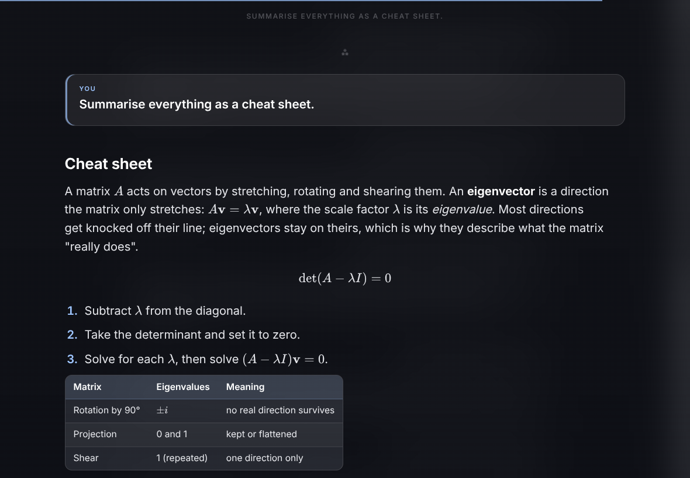
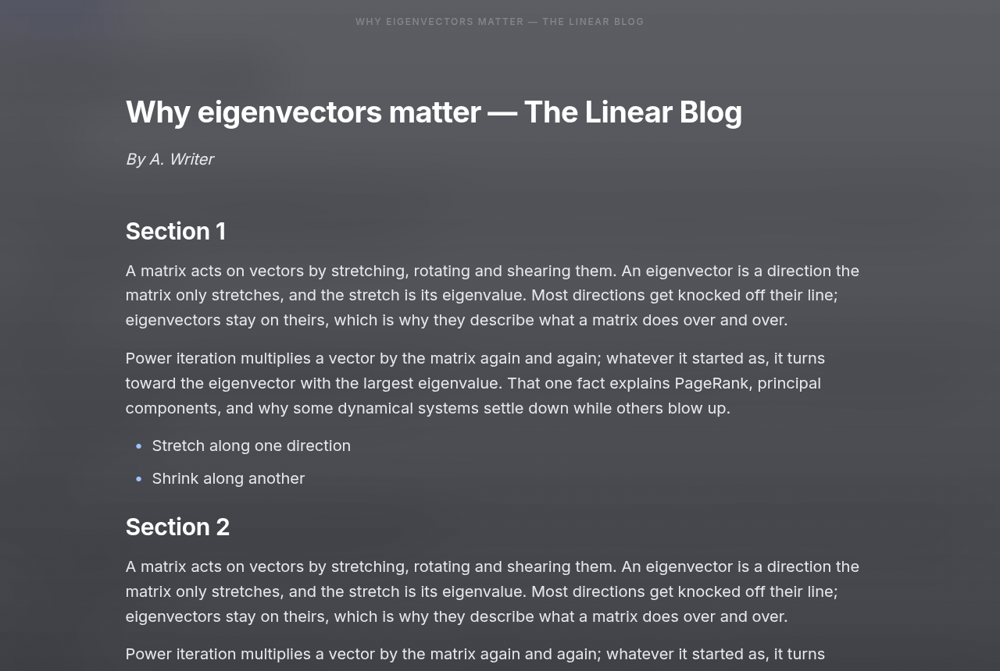
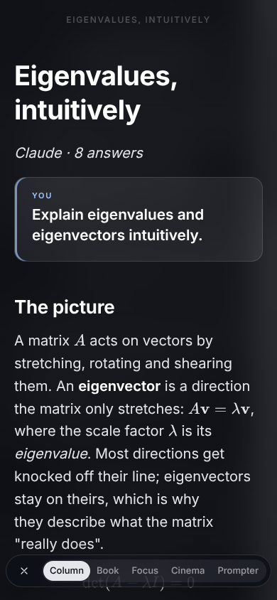

# Glass Reader

**Read long things on a calm sheet of glass.** Glass Reader lays a full-screen reader over whatever you're reading — a whole ChatGPT, Claude or Gemini conversation, an article, a GitHub pull request, a Google Doc, a PDF — and takes everything else away: no sidebars, no buttons, no clutter. Just the text, set in good type, with maths, tables, code and images intact.

[](https://github.com/IshanG7240/glass-reader/releases/latest)
[](LICENSE)



<p>
  
  
</p>

## Why

AI chats are where a lot of studying happens now, and chat windows are bad at long reading: narrow columns, endless scrolling, the next prompt box always in view. Glass Reader turns a whole conversation into one document — each of your prompts a heading, the answers in full, opening at the latest answer with everything earlier above it — and gives you reading layouts built for staying with it.

- **Whole conversations** from ChatGPT, Claude and Gemini, read with your own sign-in. Formulas stay formulas, and generated images, canvases and artifacts come along.
- **Any web page:** articles and newsletters (the article only), GitHub READMEs, issues and diffs, Google Docs.
- **Files** (desktop app): PDF, EPUB, Word, Markdown, HTML, text.
- **Five layouts:** Column, Book (two-page spread), Focus (the current passage bright, the rest faded), Cinema (one passage at a time) and Prompter (auto-scrolling).
- **Ten backgrounds**, from see-through Glass to themes matched to the light in your room, with tuned size, line width and line height.
- **Private:** everything happens on your device. No account, no server, no tracking.

## Download

Get it from the [latest release](https://github.com/IshanG7240/glass-reader/releases/latest):

| Where | Download | What it does |
| --- | --- | --- |
| **Chrome, Edge, Brave** (Windows, Mac, Linux) | [glass-reader-extension.zip](https://github.com/IshanG7240/glass-reader/releases/latest/download/glass-reader-extension.zip) | A toolbar button that opens the page you're on in the reader. [Install](#browser-extension-chrome-edge-brave) |
| **iPad, iPhone** (Safari) | [glass-reader.user.js](https://github.com/IshanG7240/glass-reader/releases/latest/download/glass-reader.user.js) | A READ tab on ChatGPT, Claude and Gemini conversations. [Install](#ipad-and-iphone-chatgpt-claude-and-gemini-conversations) |
| **Android** | [glass-reader.apk](https://github.com/IshanG7240/glass-reader/releases/latest/download/glass-reader.apk) | Reads conversations straight from the ChatGPT, Claude and Gemini apps; opens anything you share. [Install](#android-chatgpt-claude-and-gemini-apps) |
| **Linux desktop** | from source | The full app: files, a global hotkey that reads whatever window you're in, Claude Code sessions. [Set up](#linux-desktop-app) |

## Using it

Tap or move the mouse to bring up the control bar. With a keyboard:

| Key | Does |
| --- | --- |
| `1`–`5` | Column, Book, Focus, Cinema, Prompter |
| `←` `→` / swipe | Turn the page (Book, Focus, Cinema) |
| `P` | Auto-play Focus, Cinema and Prompter (`,` `.` slower / faster) |
| `−` `+` · `[` `]` | Text size · line width |
| `T` · `F` | Background · typeface |
| `C` | Read the page again (a chat that has grown) |
| `Esc` | Close |

Your place in each document is remembered. More in [Layouts](#layouts).

## Privacy

Glass Reader reads a page only when you ask it to (the button, the tab or the hotkey), using the sign-in you already have on that site, the same way the site's own page does. What it reads stays on your device: there is no server, no account, no analytics. Details: [PRIVACY.md](extension/standalone/PRIVACY.md).

## Browser extension (Chrome, Edge, Brave)

A version that needs nothing else installed: no desktop app, no shortcuts to set up. Click its toolbar button (or press **Alt+Shift+R**) and the page you're on opens in the reader, laid over it: articles and newsletters, GitHub READMEs, issues and pull requests (as a diff), Google Docs, and whole ChatGPT, Claude and Gemini conversations, opened at the latest answer. Click it again, or press Esc, to put it away; **C** reads the page again (a chat that has grown).

**Install:** download [glass-reader-extension.zip](https://github.com/IshanG7240/glass-reader/releases/latest/download/glass-reader-extension.zip) and unzip it. Open `chrome://extensions` (`edge://extensions` in Edge), turn on **Developer mode**, click **Load unpacked** and pick the unzipped folder. The button may hide under the puzzle-piece menu; the pin puts it on the toolbar.

**Permissions:** it asks only for `activeTab` and `scripting`, so the install prompt shows no "read all your data" warning: it sees a page only when you click its button there.

**Under the hood:** it is the same reader as the iPad userscript (`ios/overlay.js`, built with `extension: true`) and reads pages with the same code as the desktop companion (`extension/browser/background.js`, from `captureTab()` on). PDFs and diagrams open in the desktop app only. Not on Firefox yet.

## iPad and iPhone: ChatGPT, Claude and Gemini conversations

On iOS no app can read another app's screen, so Glass Reader works inside **Safari**, as a userscript run by the free **Userscripts** app (App Store). It doesn't need a Mac, Xcode or a developer account. On a ChatGPT, Claude or Gemini conversation, a small glass tab sits on the right edge (a blue-violet READ tab). Tap it (or press **Ctrl+Option+C** on a keyboard) and the **whole conversation** opens over the page at the latest answer, with earlier prompts and answers above it. It uses the same reader, layouts, maths, tables and code as the desktop app.

- **Glass** shows the conversation behind the text, blurred. **T** or the theme button cycles through the others.
- **Tap** to bring up the controls; **✕** (first on the bar) closes the reader. In Book, Focus and Cinema, swipe to turn pages.
- **C** reads the conversation again (after new answers). With text selected, only the selection opens.
- The capture is the browser extension's own code (`extract()` in `extension/browser/background.js`): ChatGPT and Claude are read from the API the page itself uses, with your sign-in; Gemini is read from the page, scrolling up first so older turns load. Nothing is sent anywhere; the reader runs in a frame of the same page.
- Using the ChatGPT, Claude or Gemini **app**? Conversations sync, so open the same chat in Safari (it's in the sidebar history) and tap the tab there.
- Not on iOS: PDF, EPUB and Word files, Mermaid diagrams (shown as their source), and the Claude Code features. Those need the desktop app.

Set up, once:

1. Install **Userscripts** from the App Store and open it once. It asks where to keep scripts; the default folder is fine.
2. Turn it on: **Settings → Apps → Safari → Extensions → Userscripts**: on, and **Allow** for chatgpt.com, claude.ai and gemini.google.com (or All Websites).
3. In Safari, download [glass-reader.user.js](https://github.com/IshanG7240/glass-reader/releases/latest/download/glass-reader.user.js). Then in the **Files** app, move it from Downloads into the **Userscripts** folder.
4. Open a conversation in Safari and tap the READ tab on the right edge.

Updating: download the new file and replace the old one in the Userscripts folder. Building it yourself: `npm run build:ios`, then `npm run serve:ios` prints an address to open on the iPad (same Wi-Fi; on campus and guest networks that keep devices apart, send yourself the file instead). Home Screen web apps don't run Safari extensions, so open the chats in a Safari tab (pinned tabs work). Desktop userscript managers (Tampermonkey, Violentmonkey) run the same file.

## Android: ChatGPT, Claude and Gemini apps

The Android app reads conversations straight from the **apps**, and opens anything you share or select. It is the same reader (layouts, themes, maths, tables, code) running in a full-screen view.

- **Read button.** Turn on *Reading from the screen* (the welcome card has a button; Android asks you to allow Glass Reader under Accessibility). In a ChatGPT, Claude or Gemini chat a small glass button sits on the right edge (drag it up or down; drag it onto the ✕ that appears at the bottom to hide it for 10 minutes, and tap the notification to bring it back sooner). Tap it: Glass Reader scrolls to the top of the chat, back down screen by screen, and opens the **whole conversation** at the latest answer. Tap the dimmed screen to stop. It only looks at those three apps, only when you tap the button, and nothing leaves the phone.
- **Share or select.** Share a message, a file (PDF, EPUB, Word, Markdown, text) or a link to Glass Reader, or select text and pick **Glass Reader** in the selection menu. A shared ChatGPT, Claude or Gemini **share link** is opened in the background and read with the browser extension's `extract()`; other links go through Readability.
- **Tap** shows the controls and they stay until you tap again (12 seconds if you leave them). In Book and Cinema, tap the sides (or swipe) to turn pages; in Focus, swipe. Volume keys turn pages; **Back** goes to the previous document, then closes.
- **Glass** shows the chat you were reading, blurred (a picture taken when you tapped Read).

What the screen gives, and what it doesn't: headings, lists (nested), tables, code with its language, quotes, Gemini's maths and bold in Claude come through. ChatGPT and Gemini don't expose bold, link addresses are not on screen, Claude's maths arrives as spoken text ("fraction V 100"), and Gemini numbered lists come out as bullets. For a perfect copy, use the app's share link.

Build and install (needs a JDK 17+ and the Android SDK; USB debugging on):

```bash
npm run build:android                # → dist/glass-reader.apk
npm run build:android -- --install   # and install it on the phone connected over USB
```

It uses `~/Android/jdk` and `~/Android/Sdk` unless `JAVA_HOME` / `ANDROID_HOME` are set. Without a cable, copy `dist/glass-reader.apk` to the phone and open it (Android asks to allow installing from that app once). The build copies `renderer/`, the fonts and libraries from `node_modules/` (run `npm install` first) and the extension's `background.js` and `Readability.js` into the app. Reinstalling turns the accessibility service off; `--install` turns it back on, otherwise do it in Settings → Accessibility. Debug builds also take `adb shell am broadcast -a dev.glassreader.READ` (as if the button was tapped) and `-a dev.glassreader.DUMP` (what the screen exposes, to logcat); only adb can send them.

## Linux desktop app

The original: a full-screen overlay for files, plus capture from whatever app has focus.

### Run it

```bash
npm install
npm start                      # opens the overlay
npm start -- path/to/book.pdf  # opens straight into a file
```

While it is running, launching it again talks to the running copy:

```bash
bin/glass-reader --toggle   # show / hide
bin/glass-reader file.epub  # open a file in the running overlay
bin/glass-reader --quit
```

#### Ubuntu: one-time sandbox setup

Ubuntu 23.10+ only lets apps with an AppArmor profile use the sandbox Electron needs. Without one, the reader crashes whenever GNOME starts it (hotkeys, autostart, launcher). Add the same kind of profile VS Code and Chrome ship:

```bash
sudo scripts/install-apparmor.sh        # --uninstall to remove
```

#### Global hotkey (GNOME / Wayland)

```bash
scripts/install-gnome.sh                  # default shortcut: Ctrl+Alt+R
scripts/install-gnome.sh "<Super>r"       # or choose your own
scripts/install-gnome.sh --uninstall
```

This adds a launcher entry, starts the reader in the background at login (so the overlay appears instantly), and registers a custom shortcut that runs `--toggle`. On Wayland, apps cannot grab global keys themselves, so GNOME's own shortcut system is the reliable route.

### Ctrl+Alt+C: read what you're looking at

One key, wherever you are. It reads whatever has focus:

| Focused | What opens |
| --- | --- |
| **kitty** | The Claude Code session running in that tab (see below). |
| **VS Code / Cursor** | The open file. With text selected, just the selection. Unsaved edits are included. Saved Markdown, PDF, EPUB and HTML files open as themselves, so images and your reading position work. Code files open as a code block. With no file open, the Claude Code session in the active terminal. |
| **Brave / Chrome** | The page, cleaned up. **GitHub:** a repo or `.md` file opens as its real Markdown (tables, Mermaid, images); a PR's Files changed tab (all of it, one commit or a range), a commit or a comparison opens as its diff: a table of files, then each file's changes with added and removed lines tinted (lockfiles, minified and 800+-line files are listed but not shown); issues, PRs and discussions as their posts. **Articles, Substack, newsletters, blogs:** the article only, with title, author and images, via Readability (Firefox Reader View's engine). **ChatGPT, Claude and Gemini chats:** the whole conversation, each prompt a heading, opening at the latest answer (like Claude Code sessions), with formulas drawn properly. ChatGPT canvases and Claude artifacts (documents, code, HTML, SVG, Mermaid) come along in their latest version, after the answer that last changed them; so do images ChatGPT made and ones you attached. Gemini: pictures it made, and the canvas or Deep Research report that is open at the side (open it before pressing the key; a code canvas may come through only as far as it is scrolled into view). **Formulas anywhere** (KaTeX, MathJax, Wikipedia, MathML) are kept as formulas. **Google Docs:** the document itself (Docs' own Markdown export, the tab you're on), not the editor around it. **Pages whose content sits in an iframe** (Claude artifacts, embeds): the frame with the most text. With text selected, just the selection. Signed-in and subscriber pages work, since it reads the tab you see. |
| anything else | The Claude Code session picker. |

How it knows: GNOME on Wayland doesn't tell apps which window has focus, so each app reports it itself in `~/.cache/glass-reader/focus/`. When you press the key, `bin/read-focused.js` asks the focused app for its content over a private Unix socket (yours only). No network port is opened and nothing leaves your machine. Pages and unsaved files are saved in `~/.cache/glass-reader/captures/` (newest 40 kept). The reader comes up at once on a blank page while the content arrives, and each capture is logged in `~/.cache/glass-reader/capture.log` (app, URL or file, title).

Setup:

```bash
scripts/install-gnome.sh          # Ctrl+Alt+R, Ctrl+Alt+C and the claude-read command
scripts/install-kitty.sh          # kitty focus watcher (edits kitty.conf with a backup; --uninstall to remove)
scripts/install-extensions.sh     # VS Code / Cursor extension and the browser helper (--uninstall to remove)
```

Then, once in each browser (brave://extensions or chrome://extensions): turn on **Developer mode**, **Load unpacked**, choose `extension/browser`. Browsers don't let a script install extensions. Already-open VS Code / Cursor windows pick their extension up after **Developer: Reload Window**, and existing kitty windows after a restart.

### Claude Code answers

Long answers are hard to read in a terminal. Glass Reader opens a Claude Code session as one document: the whole conversation, scrolled to the latest answer, with your earlier prompts and answers above it to scroll back to.

| How | What happens |
| --- | --- |
| **Ctrl+Alt+C** in kitty | Opens the session running in that tab. Where Glass Reader can't tell which session you mean, it opens the **session picker**: every running session by name, project and how recently it answered, ↑↓ / 1–9 and Enter. **C** inside the reader opens the picker too. |
| **Automatic** (Stop hook) | When Claude finishes an answer of 250+ words, the session is queued in the reader and a notification appears. Press **Ctrl+Alt+R** (or click **Read**) and it opens. If the reader is already open, it doesn't replace your page; press **N** to switch. |
| **`claude-read`** | From a terminal. Inside Claude Code (`! claude-read`) it opens that session, but Claude sees the command and may reply to it, so prefer the shortcut. |

How it knows the tab: a small kitty watcher (`bin/kitty_focus_watcher.py`) records the focused kitty window, and Claude Code's `~/.claude/sessions/<pid>.json` maps that tab's process to its conversation. No kitty remote control is needed.

**Backspace** returns to whatever you were reading before. Claude's Markdown comes through intact: headings, lists, tables, code, and Mermaid diagrams. Each prompt is a quiet "You" heading; the answer's own headings sit below it. Every time Claude stops, its answer is kept: the text after its last tool call, without "let me look at…" narration. That is what focus mode shows you, so nothing you would have seen is missing:

- **Updates nobody prompted.** In long runs that delegate to subagents or background commands, Claude posts an update each time one reports back. Each is its own section, headed "Update" with what woke Claude (for example *Agent "Fix account health check" finished*).
- **Messages you send while Claude is working** are shown under the answer they changed.
- **Slash commands** (`/backlog-run …`), `!` shell commands Claude answered, pasted text and screenshots count as prompts. Usage-limit and API-error notices appear in italics in the answer they interrupted; an answer that was cut off and resumed reads as one answer.

The document and the picker use the session's title as Claude Code shows it (your `/rename`, else the generated one), not the folder-based process name. Documents are saved in `~/.cache/glass-reader/claude/` (one per session, newest 40 kept).

Setup: `scripts/install-claude-hook.sh` adds the automatic Stop hook to `~/.claude/settings.json` (`--uninstall` to remove). The shortcuts are set up above.

Tuning: `GR_CLAUDE_MIN_WORDS=400` changes the threshold; `GR_CLAUDE_NOTIFY=0` turns off notifications.

## Formats

| Format | Text | Images and diagrams |
| --- | --- | --- |
| PDF | Rebuilds lines from positioned text, removes running headers/footers and page numbers, rejoins hyphenated words, infers paragraphs, headings and bullets. Tables (rows of short cells on shared baselines) are rebuilt as real tables. | Pages that draw images or vector graphics are rendered; text is masked out and the remaining "ink" is grouped into figures, cropped, and placed back in reading order. Labels inside a figure stay in the picture instead of leaking into the text. A table's ruled lines are not mistaken for a figure. Line art gets a transparent background and is re-inked for dark themes. Scanned pages come through as images (no OCR yet). |
| Markdown | Full GFM: headings, lists, task lists, quotes, code, tables. Formulas: `$$…$$`, `\[…\]`, `\(…\)`, and `$…$` when it is clearly maths (prices like $5 stay text), drawn with KaTeX. | Images (web links, and local files next to the document in the desktop app), inline `<svg>`, and ```` ```mermaid ```` blocks drawn in the reader's colours. |
| EPUB | Chapters in spine order with chapter breaks. | Embedded images, SVG covers, inline SVG. |
| DOCX | Headings, lists, tables. | Embedded PNG/JPEG/GIF images. Word drawings, SmartArt and EMF/WMF images are skipped. |
| HTML | Uses `<article>` / `<main>` if present. Formulas from KaTeX, MathJax, Wikipedia and MathML are redrawn in the reader's type. | Images and inline SVG, Mermaid `<pre class="mermaid">`. |
| Text | Joins hard-wrapped lines back into paragraphs, detects simple headings and lists. | — |

In Focus and Cinema, each image or diagram is its own step.

Test files: `samples/diagrams.md` (Mermaid, local image, inline SVG) and `samples/test-figures.pdf` (built by `npm run test-pdf`).

## Layouts

| Key | Layout | What it is for |
| --- | --- | --- |
| 1 | Column | A continuous, well-proportioned page |
| 2 | Book | A paginated two-page spread |
| 3 | Focus | The current passage bright, everything else faded, like song lyrics |
| 4 | Cinema | One passage at a time, large and centred |
| 5 | Prompter | Auto-scrolling teleprompter with a fixed reading line |

`P` auto-plays Focus, Cinema and Prompter (`,` `.` change words per minute). In Focus and Cinema, words light up at your reading speed.

**Typography:** `−` `+` size · `[` `]` line width · `L` / `Shift+L` line height · `F` typeface · `A` justify · `I` indents · `T` background (Glass, Studio, Frost, Clear, Daylight, Paper, Lamp, Dusk, Night, Lights out). Studio is a spotlit dark backdrop where the text fades out at the top and bottom edges. Daylight → Lights out are matched to the light in the room:

| Theme | Room | Why |
|---|---|---|
| Daylight | bright room, sunlight | Dark text on a bright page reads best when the room is bright: the pupil narrows and the image sharpens (Piepenbrock et al. 2014; Dobres et al. 2017). Highest contrast, slightly heavier text against glare. |
| Paper | well-lit room | Same polarity, softer and warmer. |
| Lamp | evening, lamp-lit | Still light, but dimmer than white so the screen doesn't outshine the room (Benedetto et al. 2014: high screen luminance raises fatigue). |
| Dusk | dim room | Light on dark measured less fatigue in dim light (Xie et al. 2021). Charcoal, not black, because pure white on black glows (halation). |
| Night | dark room | Brighter text on near-black. |
| Lights out | dark room, before sleep | Very little light leaves the screen, contrast stays about 7:1. Dimming matters more for sleep than colour (Chang et al. 2015; LRC Night Shift study), so dim the screen too. Not amber: 2800 K was the most tiring setting at every light level. |

Line height is derived from text size and line width, so every combination stays comfortable. `L` only nudges it.

Your reading position is saved per document and restored when you reopen it.

## Build from source

Needs Node.js 20+.

```bash
npm install
npm run build:extension   # → dist/glass-reader-extension/ and dist/glass-reader-extension.zip
npm run build:ios         # → dist/glass-reader.user.js
npm run serve:ios         # hands that file to an iPad on the same Wi-Fi
npm run build:android     # → dist/glass-reader.apk (needs a JDK 17+ and the Android SDK)
npm start                 # the desktop app
```

Tests, offline, with screenshots:

```bash
npm run test:extension    # the extension in real Chrome (headless), against made-up ChatGPT, Claude,
                          # Gemini and blog pages with each site's real security headers
npm run test:ios          # the userscript at iPad and iPhone sizes, same pages
```

## Layout of the code

```
main.js            background process: overlay window, single instance, file I/O, wallpaper
preload.js         the small API the page is allowed to use
renderer/
  parsers.js       every format → one block model (h1–h6, p, li, quote, code, table, img, diagram, math)
  app.js           layouts, auto-play, settings, input
  styles.css       glass, typography, layouts
bin/
  glass-reader          launcher (checks the Ubuntu sandbox setup first)
  claude-to-reader.js   Claude Code sessions → reader documents; session lookup and picker data
  read-focused.js       Ctrl+Alt+C: finds the focused app and asks it for its content
  browser-host.js       browser helper (native messaging): focus + current tab for read-focused.js
  kitty_focus_watcher.py  kitty watcher: records which kitty window has focus
  claude-read           command-line entry point
extension/
  browser/        Brave / Chrome extension (load unpacked); Readability.js is Mozilla's, Apache-2.0
  standalone/     the shareable extension: background.js (toolbar button), icons, PRIVACY.md, test/
  vscode/         VS Code / Cursor extension
ios/
  overlay.js      the in-page reader: the iPad userscript (tab, overlay frame, capture → reader),
                  and, built with extension: true, the standalone extension's reader.js
  overlay.css     reader styles for touch screens and for sitting on top of a chat page
  test/           npm run test:ios: offline end-to-end check with screenshots
android/           the Android app (Gradle; minSdk 28)
  app/src/main/java/dev/glassreader/
    ReaderActivity.kt   the reader: full-screen WebView, share / select / open-with, back and volume keys
    Assets.kt           serves the reader and the documents to the WebView
    CaptureService.kt   accessibility service: the Read button (drag to hide), screenshots for Glass
    Notify.kt           "Read button hidden · tap to show it" notification
    ChatReader.kt       scrolls a chat top to bottom and collects what's on screen
    Formatter.kt        screen layout → Markdown (ChatGPT and Claude by layout, Gemini by line)
    LinkCapture.kt      share links: loads the page out of sight and runs extract()
  web/              shim.js (stands in for preload.js) and android.css (phone controls)
scripts/
  build-userscript.js       bundles renderer/ + fonts + extract() into dist/glass-reader.user.js
  build-extension.js        the standalone extension: dist/glass-reader-extension/ and .zip
  make-icons.js             draws its toolbar icons (npx electron scripts/make-icons.js)
  build-android.js          builds the Android app into dist/glass-reader.apk (--install: onto the phone)
  serve-userscript.js       hands that file to a phone or tablet on the same Wi-Fi
  install-gnome.sh          launcher, autostart and shortcuts
  install-kitty.sh          kitty focus watcher
  install-extensions.sh     VS Code / Cursor extension and browser helper
  install-claude-hook.sh    automatic Stop hook
  install-apparmor.sh       one-time Ubuntu sandbox profile (sudo)
  make-test-pdf.js          builds samples/test-figures.pdf for testing the PDF cleaner
```

## Contributing

Issues and pull requests are welcome. Fork the repo, make your change on a branch, and open a pull request against `main`; changes land after review. See [CONTRIBUTING.md](CONTRIBUTING.md). If a chat or page comes out badly formatted, please open an issue with the line at the bottom of the document ("Read from …"), and a share link if you can.

## Roadmap

1. Capture from more apps: selected text anywhere (`wl-paste --primary`), Firefox, other terminals.
2. Accessibility-API (AT-SPI) capture for other apps, with OCR as a fallback.
3. Optional AI reformatting for badly broken text.

## License

[ISC](LICENSE). Readability.js is Mozilla's, under the Apache License 2.0 ([its license](extension/browser/Readability-LICENSE.md)).
