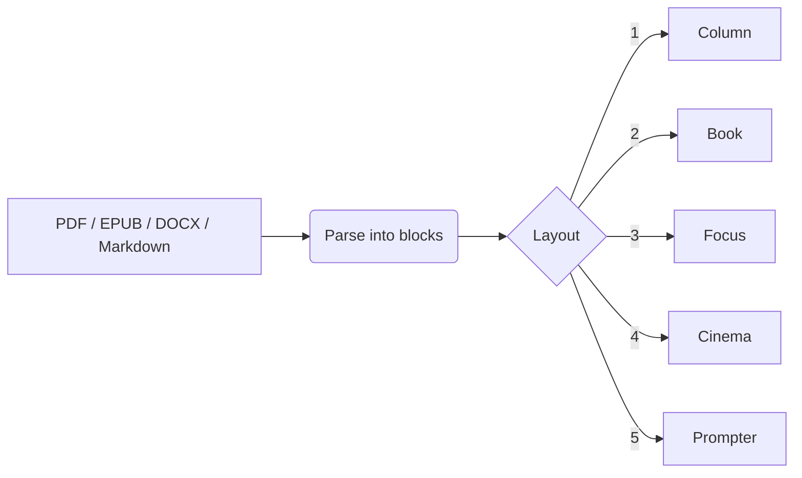
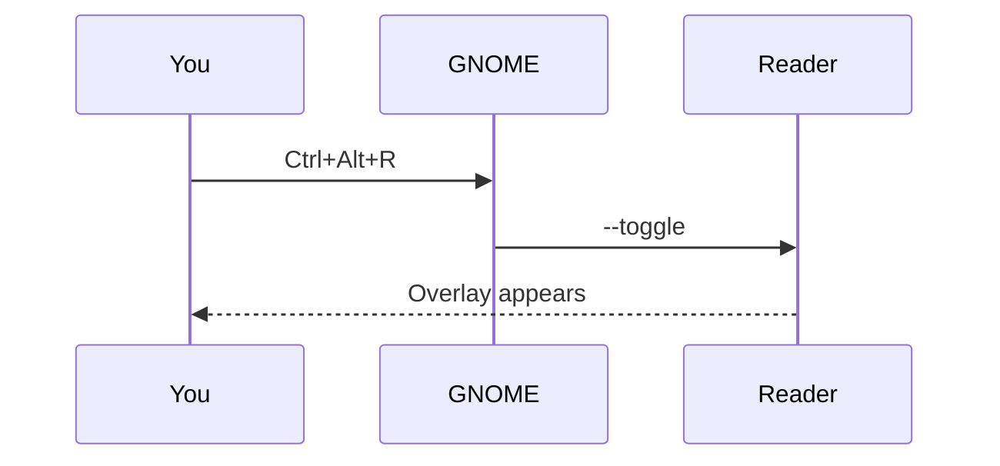
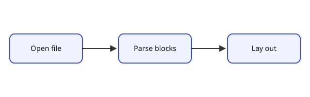

# Pictures and Diagrams

This page checks that images and diagrams survive the trip into the reader.

## A Mermaid flowchart

The reader turns every format into the same simple list of blocks before laying anything out.

## A sequence diagram

## A local image

Images stored next to the document are loaded from the same folder.

## An inline drawing

<svg viewBox="0 0 300 120" width="300" height="120" xmlns="http://www.w3.org/2000/svg">
  <circle cx="60" cy="60" r="40" fill="none" stroke="#222" stroke-width="3"/>
  <rect x="130" y="25" width="140" height="70" rx="12" fill="none" stroke="#222" stroke-width="3"/>
  <text x="200" y="66" font-size="16" text-anchor="middle" font-family="sans-serif">glass</text>
</svg>

That is the end of the test page.
